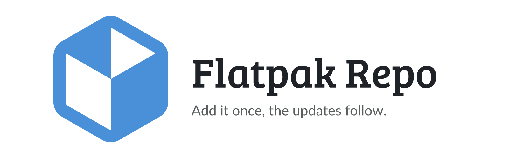

<p align="center">
  <picture>
    <source media="(prefers-color-scheme: dark)" srcset="https://raw.githubusercontent.com/junkerderprovinz/flatpak/main/.github/assets/flatpak-banner-dark.png">
    
  </picture>
</p>

<p align="center">
  <a href="https://github.com/junkerderprovinz/flatpak/actions/workflows/publish.yml"></a>&nbsp;
  <a href="https://github.com/junkerderprovinz/flatpak/actions/workflows/style.yml"></a>&nbsp;
  <a href="https://junkerderprovinz.github.io/flatpak/"></a>&nbsp;
  <a href="#2-install"></a>&nbsp;
  <a href="LICENSE"></a>
</p>

<p align="center">
This repository builds the Flatpak repository for my desktop apps. Add it once, and new versions come in through <code>flatpak update</code> or your software center like any other app. Every app is on <a href="https://junkerderprovinz.github.io/flatpak/">the page</a>, ready to install.
</p>

<br>

<p><a id="table-of-contents" href="#table-of-contents"><picture><source media="(prefers-color-scheme: dark)" srcset=".github/assets/sections/table-of-contents-dark.svg"></picture></a></p>

1. [Support](#1-support)
2. [Install](#2-install)
3. [Going back a version](#3-going-back-a-version)
4. [How it is built](#4-how-it-is-built)
5. [Adding an app](#5-adding-an-app)
6. [The signing key](#6-the-signing-key)
7. [Testing locally](#7-testing-locally)
8. [How AI is used here](#8-how-ai-is-used-here)

<br>

<p><a id="1-support" href="#1-support"><picture><source media="(prefers-color-scheme: dark)" srcset=".github/assets/sections/1-support-dark.svg"></picture></a></p>

<p align="center">
A one-knight job: I build it, keep it running, work through the issues and add what people ask for, until nothing is missing. It is free, with no accounts, no telemetry, no ads and no paid tier. No asterisk anywhere. Nothing readable ever leaves your own walls. Forged on evenings and weekends, with heart and stubbornness.
</p>

<p align="center">
If it has earned a place on your server or computer, toss a coin to your knight: it helps cover the costs and keeps the project alive. It also makes this knight's heart beat a little faster. Three ways below, whichever suits you.
</p>

<br>

<p align="center">
  <a href="https://buymeacoffee.com/junkerderprovinz"></a>
  &nbsp;
  <a href="https://www.paypal.com/donate/?hosted_button_id=76FVV52TKXTUS"></a>
  &nbsp;
  <a href="https://junkerderprovinz.github.io/junkerderprovinz/"></a>
</p>

<br>

<p><a id="2-install" href="#2-install"><picture><source media="(prefers-color-scheme: dark)" srcset=".github/assets/sections/2-install-dark.svg"></picture></a></p>

```sh
flatpak remote-add --user --if-not-exists junkerderprovinz https://junkerderprovinz.github.io/flatpak/junkerderprovinz.flatpakrepo
flatpak install junkerderprovinz io.github.junkerderprovinz.arrowloop
```

The apps run on the GNOME runtime from Flathub. Most systems have Flathub set up already. If yours doesn't, add it before the install:

```sh
flatpak remote-add --user --if-not-exists flathub https://dl.flathub.org/repo/flathub.flatpakrepo
```

You can skip all of this and click Install on [the page](https://junkerderprovinz.github.io/flatpak/) instead. Each app has a `.flatpakref` there that brings both repositories along.

| App | App ID |
|-----|--------|
| [ArrowLoop](https://github.com/junkerderprovinz/arrowloop) | `io.github.junkerderprovinz.arrowloop` |

<br>

<p><a id="3-going-back-a-version" href="#3-going-back-a-version"><picture><source media="(prefers-color-scheme: dark)" srcset=".github/assets/sections/3-going-back-a-version-dark.svg"></picture></a></p>

The version before the current one stays in the repository, so a release that gives you trouble is easy to step back from:

```sh
flatpak remote-info --log junkerderprovinz io.github.junkerderprovinz.arrowloop
flatpak update --commit=<commit from the log> io.github.junkerderprovinz.arrowloop
```

A plain `flatpak update` later brings you back to the newest one.

<br>

<p><a id="4-how-it-is-built" href="#4-how-it-is-built"><picture><source media="(prefers-color-scheme: dark)" srcset=".github/assets/sections/4-how-it-is-built-dark.svg"></picture></a></p>

[`publish.yml`](.github/workflows/publish.yml) runs `build.sh` and puts the result on GitHub Pages. It runs when an app publishes a release, once a week, and on every push to `main`.

`build.sh` starts from the repository that is already published, so the history survives the rebuild. For every app in [`apps.txt`](apps.txt) it downloads the amd64 and arm64 bundles of the newest release and commits each one on top of the version before it, signed. Then it adds the update deltas, keeps the newest two versions of each app (`KEEP_VERSIONS`) and writes the `.flatpakrepo`, the `.flatpakref` files and the page. The build stops at 900 MB, a good way below what Pages will serve.

<br>

<p><a id="5-adding-an-app" href="#5-adding-an-app"><picture><source media="(prefers-color-scheme: dark)" srcset=".github/assets/sections/5-adding-an-app-dark.svg"></picture></a></p>

Add a line to `apps.txt`, with the repository, the app ID and the name. That's all as long as each release carries `<repo>-linux-amd64.flatpak` and `<repo>-linux-arm64.flatpak`. To get updates out right away, the app's release workflow sends a dispatch at the end:

```yaml
      - name: Update the Flatpak repository
        env:
          GH_TOKEN: ${{ secrets.FLATPAK_DISPATCH_TOKEN }}
        run: gh api repos/junkerderprovinz/flatpak/dispatches -f event_type=release
```

`FLATPAK_DISPATCH_TOKEN` is a fine-grained token for this repository alone, with read and write access to its contents.

<br>

<p><a id="6-the-signing-key" href="#6-the-signing-key"><picture><source media="(prefers-color-scheme: dark)" srcset=".github/assets/sections/6-the-signing-key-dark.svg"></picture></a></p>

The private key lives in the `FLATPAK_SIGNING_KEY` secret and nowhere else. The public half is exported from it on every build, so it never has to be kept in sync by hand. To make the key, in a throwaway GnuPG home:

```sh
export GNUPGHOME=$(mktemp -d)
gpg --batch --passphrase '' --quick-gen-key 'Junker der Provinz Flatpak' ed25519 sign never
gpg --armor --export-secret-keys | gh secret set FLATPAK_SIGNING_KEY -R junkerderprovinz/flatpak
gpg --armor --export-secret-keys > ~/flatpak-signing-key.asc   # into the password manager, then delete it
gpg --fingerprint
rm -rf "$GNUPGHOME"
```

Changing the key later locks everyone out who added the old one, and the next build stops too, because it checks the published repository against the current key. So keep the backup safe.

<br>

<p><a id="7-testing-locally" href="#7-testing-locally"><picture><source media="(prefers-color-scheme: dark)" srcset=".github/assets/sections/7-testing-locally-dark.svg"></picture></a></p>

`build.sh` needs `flatpak`, `ostree`, `gpg` and `curl`. The image the workflow uses has all of them. Point `BASE_URL` at the address you serve the output from:

```sh
BASE_URL=http://localhost:8000 ./build.sh public
python3 -m http.server 8000 -d public
```

<br>

<p><a id="8-how-ai-is-used-here" href="#8-how-ai-is-used-here"><picture><source media="(prefers-color-scheme: dark)" srcset=".github/assets/sections/8-how-ai-is-used-here-dark.svg"></picture></a></p>

One knight builds this, and AI is one of the tools I work with, the same way I work with an editor or a compiler. It helps me write code and documentation and it checks my work, and that saves me a good many evenings. It does not make the decisions, though. I read and understand everything before it ships, and if something here breaks, that is on me and not on the tool.

You do not have to take my word for it. The code is open and every release note is written by hand. The issue tracker shows how problems actually get handled, including the ones I got wrong the first time. If you find something that is not right, open an issue and I will look at it.

<br>

Questions, bugs or ideas? Please [open a GitHub issue](https://github.com/junkerderprovinz/flatpak/issues), I'm always glad to hear from you.
